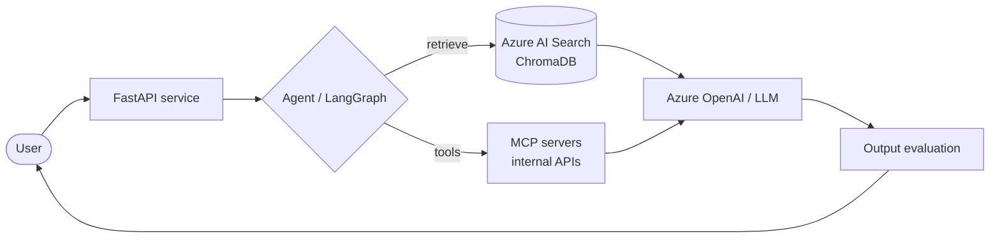

<div align="center">


<a href="https://github.com/hemuush">
  
</a>

<br><br>

[](https://www.linkedin.com/in/hemuush/)
[](mailto:hemant.shrma.3004@gmail.com)
[](#)


</div>

---

## 👋 About me

GenAI and Agentic AI engineer with **4+ years in backend engineering**, the last ~2 building **production GenAI systems on Azure**: RAG pipelines, multi-agent workflows and MCP-based integrations.

```python
class Hemant:
    role     = "GenAI & Agentic AI Engineer"
    based_in = "Noida, India"
    focus    = ["RAG", "Multi-agent orchestration", "MCP servers", "LLM evaluation"]
    stack    = ["Python", "FastAPI", "LangGraph", "Azure AI Foundry"]
    currently = "Shipping GenAI assistants used across 10+ departments"
    open_to  = "Collaborations, interesting problems, good coffee ☕"
```

## 📊 Impact at a glance

<div align="center">

| 🔻 **~70%** | 🏢 **10+** | 💬 **~1,000** | 🧾 **~2,000** |
|:---:|:---:|:---:|:---:|
| lower speech-model hosting cost | departments served by GenMobius | chat requests handled per day | client accounts on KIGS |

</div>

## 🚀 Featured projects

<details open>
<summary><b>🎙️ Felix — executive-voice AI assistant</b></summary>
<br>

- Built on **Azure Custom Neural Voice**, trained on custom voice samples.
- Re-architected training and inference, **cutting hosting cost by ~70%**.

`Azure Custom Neural Voice` `Python` `Azure Cost Management`
</details>

<details open>
<summary><b>🤖 GenMobius — company-wide GenAI assistant</b></summary>
<br>

- Serves **10+ departments**, handling ~**1,000 chat requests** and ~**100 tickets** a day.
- Includes **MarketBot**, a news module with an accuracy-tracking dashboard to monitor relevance quality.
- Custom **MCP servers** expose 5–10 internal APIs as agent tools.
- **RAG** pipelines with semantic chunking and embedding search over Azure AI Search and ChromaDB.

`LangChain` `LangGraph` `MCP` `Azure AI Search` `ChromaDB` `FastAPI`
</details>

<details>
<summary><b>🕵️ BackcheckAI — automated background checks</b></summary>
<br>

- Processes ~**30–40 background checks a month**.
- Scrapes sources with **Playwright**, parses PDFs with **Azure Document Intelligence**, and runs prompt-based risk classification.
- Automates a manual due-diligence screening step.

`Playwright` `Azure Document Intelligence` `Prompt Engineering`
</details>

<details>
<summary><b>🧾 KIGS — GST filing & reconciliation automation</b></summary>
<br>

- Used across ~**2,000 client accounts** at KPMG India.
- Replaced manual, script-heavy workflows with a single automated tool.

`Python` `Pandas` `Automation`
</details>

### 🧩 How a typical GenAI request flows



## 💼 Experience

<details open>
<summary><b>Senior Executive · Walker Chandiok & Co LLP (Grant Thornton India)</b> — Dec 2024 → Present</summary>
<br>

Felix, GenMobius, BackcheckAI, custom MCP servers and RAG pipelines on Azure.
</details>

<details>
<summary><b>Analyst · KPMG India</b> — Jan 2022 → Nov 2024</summary>
<br>

- Built **KIGS** for GST return filing and reconciliation.
- Built a firm-wide **knowledge-search bot**, an early version of what became GenMobius.
- Developed Python data-processing pipelines for document and case review in the Forensic practice.
</details>

## 🛠️ Tech stack

<details open>
<summary><b>GenAI & Agentic AI</b></summary>
<br>


</details>

<details open>
<summary><b>Languages & Frameworks</b></summary>
<br>


</details>

<details>
<summary><b>Cloud & DevOps</b></summary>
<br>


</details>

<details>
<summary><b>Data & Storage</b></summary>
<br>


</details>

<details>
<summary><b>Tools & Practices</b></summary>
<br>


</details>

## 🎓 Education & certifications

- **B.Tech, Computer Science** — Punjabi University
- **Machine Learning** — Stanford (Coursera)
- **Python for Everybody** — Coursera
- **5-star Python** — HackerRank

## 📈 GitHub stats

<div align="center">


</div>

---

<div align="center">

### 🤝 Let's build something together

Open to collaborations on GenAI, agents and backend systems.

[](mailto:hemant.shrma.3004@gmail.com)
[](https://www.linkedin.com/in/hemuush/)


</div>
